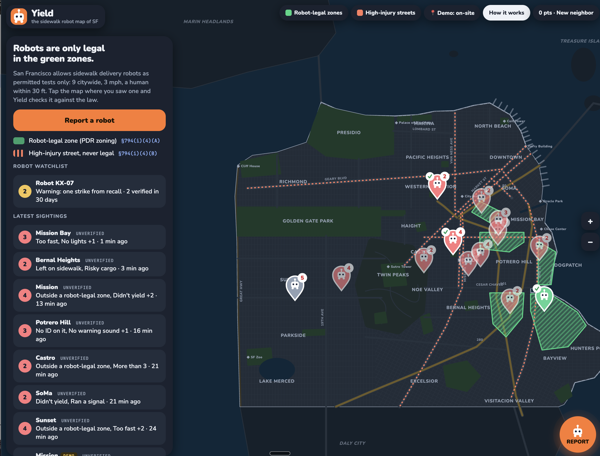

# Yield SF

**Try the live app:** https://claude.ai/artifact/4pwVEUyRW6nshrtcTjHu1K?sk=2V0LpobLHhh_1hiP09wDIA

A Waze-style map for sidewalk delivery robots in San Francisco, built on SF Public Works Code §794 as 32 machine-readable rules. Track 3D, Claude Impact Lab SF.

- `index.html`: the map. Tap where you saw a robot, pick what it did, get a clause-by-clause verdict and a 311 report. (Shared live sightings work on the published page; the local file keeps them on your device.)
- `GUARDRAILS.md`: the fixed rules behind the app: geofence, community feedback loop, three-strike robot recall, and the proposed operator fund
- `checklist.html`: the full resident and operator checklist with every rule's test
- `rules.json`: rules, each with its clause and a testable condition
- `check.py`: `python3 check.py examples/resident_fail.json` · `python3 check.py --rules`
- `examples/`: illustrative observations, not real sightings
- `SUBMISSION.md`: team card and answers

The map is hand-drawn and approximate. Confirm zoning and high-injury streets on the City's own maps.
